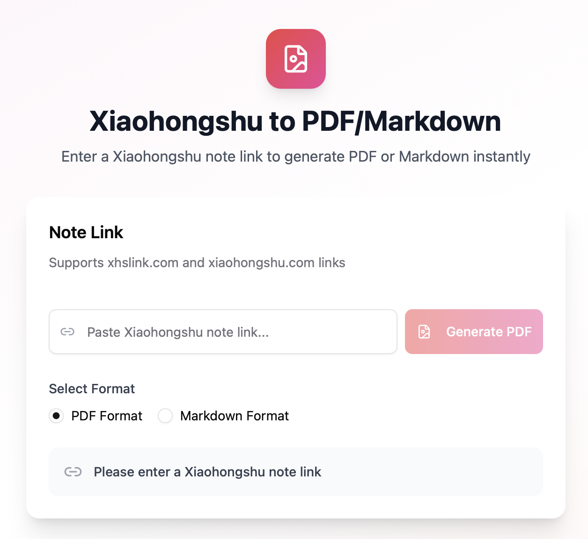

# Xiaohongshu to PDF/Markdown Converter

<div align="center">



### A lightweight web tool that converts Xiaohongshu notes into PDF and Markdown formats

[中文](README-ZH.md) • [Features](#features) • [Quick Start](#deployment) • [API](#api-endpoints)

</div>

> **The hosted demo is no longer running.** This project is open source and free to deploy yourself - see [Self-host with Railway](#self-host-with-railway-dockerfile-deployment) or run it locally in a few commands.
>
> **Never used a terminal before?** You don't have to install anything yourself - just send the repo link to an AI coding agent and let it set everything up. See [Option 0](#option-0-let-an-ai-agent-install-it-for-you-easiest).

## Features

- Supports xhslink.com, xhslink.cn, and xiaohongshu.com links
- You can paste a plain note link or the full Xiaohongshu share text; the app extracts the link automatically
- Export to PDF or Markdown format (PDF includes a text page plus images)
- Automatically extracts all images from notes
- Generates files in reading order
- Bilingual interface (Chinese/English)
- One-click download

## Project Structure

```
xhs-pdf/
├── app/                    # Frontend React application
│   ├── src/               # Source code
│   └── dist/              # Built static files
├── api/                    # Backend API
│   ├── app.py             # Main app (integrated frontend + backend)
│   ├── main.py            # API-only mode
│   ├── requirements.txt   # Python dependencies
│   └── downloads/         # Generated files
├── docs/                   # Documentation
├── README.md              # English documentation
└── README-ZH.md          # Chinese documentation
```

## Deployment

### Option 0: Let an AI agent install it for you (easiest)

Never used a terminal? You can skip every command below. Just send this repository URL to an AI coding agent that can run commands on your machine — for example **Claude Code**, **OpenAI Codex**, Cursor, or similar — together with the prompt below. The agent will clone the repo, install the dependencies, start the app, and then explain how to use it in plain language.

Copy and paste this to your agent:

```text
Please set up this project for me: https://github.com/Apple20251125/Redbook-Convert

Clone the repo, read the README, install all required dependencies, and get
the app running locally. When it is ready:

1. Tell me the exact URL to open in my browser.
2. Explain in simple, non-technical language how to paste a Xiaohongshu
   note link (or the whole share text) and export it as a PDF or Markdown
   file, including where the generated file ends up.
3. Tell me how to stop and restart the app later.

If anything fails along the way, diagnose and fix it yourself, then tell me
what you changed. Please do not skip the explanation at the end - I have
not done this before.
```

After that, just talk to the agent: "it says connection refused", "how do I put this online?", and so on. No command line needed on your side.

### Option 1: Integrated Deployment (Recommended)

Use integrated `app.py` to serve both frontend and backend:

```bash
cd api
pip install -r requirements.txt
playwright install chromium
python app.py
```

Visit http://localhost:8000 to use.

### Self-host with Railway (Dockerfile deployment)

The hosted demo has been shut down, but this repo is still ready to run on Railway via `Dockerfile` + `railway.json`. Bring up your own instance:

1. Fork or clone this repo
2. Create a Railway project and connect it to your fork (or run `railway init` locally and link the repo)
3. Railway picks up the `Dockerfile` and builds the image - no build command to configure
4. Open the domain Railway assigns to the deployment

Notes:

- Runtime entrypoint is `api/app.py` (integrated frontend + backend), not `api/main.py`
- Build includes `playwright install chromium`
- Linux container launch flags are tuned in both `api/app.py` and `api/main.py` for Railway stability
- Pushing to `main` redeploys your own Railway project automatically

### Option 2: Separate Frontend and Backend

1. Start backend API:
   ```bash
   cd api
   pip install -r requirements.txt
   playwright install chromium
   python main.py
   ```

2. Update frontend configuration:
   - Edit `app/.env`
   - Set `VITE_API_URL=http://your-backend-url:8000`
   - Leave it empty to use same-origin requests (when the API is served under the same domain)

3. Build the frontend:
   ```bash
   cd app
   npm install
   npm run build
   ```
   Frontend static files will be generated in `app/dist/`. Deploy this directory to any static hosting service.

## Troubleshooting (Docker / Playwright)

If logs show `chrome_crashpad_handler: Resource temporarily unavailable (11)`:

- Ensure latest code is deployed (contains Linux launch args in `api/app.py`)
- Confirm service actually runs `uvicorn app:app` (from `Dockerfile`)
- Trigger a manual redeploy once after updating

Quick checks:

- `GET /api/health` should return `{"status":"ok"}`
- Then call `POST /api/convert` with a valid `xhslink.com` URL

## API Endpoints

### POST /api/convert

Convert Xiaohongshu note to PDF or Markdown.

**Request Body:**
```json
{
  "url": "http://xhslink.cn/xxx",
  "format": "pdf" // or "markdown"
}
```

`url` can be a plain note link or the full share text that contains a Xiaohongshu link.

**Response:**
```json
{
  "success": true,
  "message": "Conversion successful",
  "imageCount": 19,
  "downloadUrl": "/api/download/xxx.pdf",
  "filename": "xxx.pdf"
}
```

### GET /api/download/{filename}

Download generated file.

### GET /api/health

Health check endpoint.

### POST /api/track-visit

Track an anonymous site visit.

**Request Body:**
```json
{
  "visitorId": "anonymous-uuid",
  "path": "/"
}
```

### GET /api/stats

Get traffic and conversion stats.

Open in a browser to view the dashboard; append `?format=json` for raw JSON.

**Response:**
```json
{
  "totalVisits": 120,
  "uniqueVisitors": 87,
  "totalConversions": 42,
  "pdfCount": 30,
  "markdownCount": 12,
  "lastVisitAt": "2026-05-08T03:12:00+00:00",
  "lastConversionAt": "2026-05-08T03:18:00+00:00",
  "databasePath": "/data/stats.db",
  "statsProtected": true
}
```

If `STATS_API_KEY` is configured, browser access shows a login page first; scripts can still include header `X-Stats-Key: your-key`.

## Traffic & Conversion Stats

The project now tracks:

- `totalVisits`: total site opens recorded by the frontend
- `uniqueVisitors`: approximate unique users based on an anonymous browser-local visitor ID
- `pdfCount`: number of successful PDF generations
- `markdownCount`: number of successful Markdown ZIP generations

Data is stored in SQLite. By default the backend writes to:

```bash
api/data/stats.db
```

You can override the path with:

```bash
STATS_DB_PATH=/data/stats.db
```

Recommended setup when self-hosting:

- Add a persistent volume and mount it to `/data`
- Set `STATS_DB_PATH=/data/stats.db`
- Optionally set `STATS_API_KEY=your-secret-key` to protect `/api/stats`

## Requirements

- Python 3.8+
- Node.js 18+ (for frontend development only)
- Chromium browser (automatically installed by Playwright)

## Tech Stack

- Frontend: React + TypeScript + Vite + Tailwind CSS + shadcn/ui
- Backend: FastAPI + Playwright + Pillow
- Deployment: Uvicorn

## Disclaimer

- For learning purposes only, please comply with relevant laws and regulations
- Please respect original content copyright
- Generated files are temporarily stored on the server, recommended to download promptly
